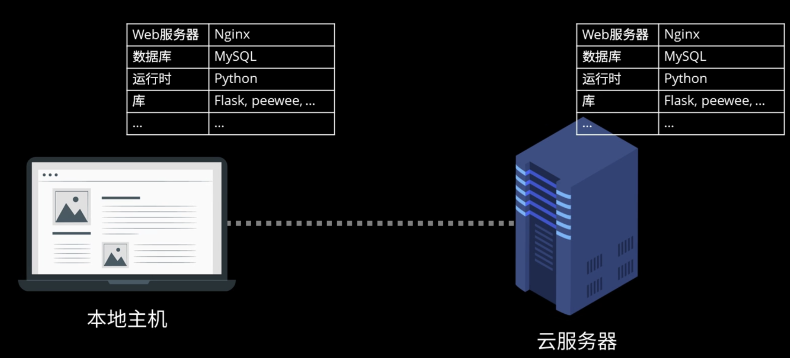
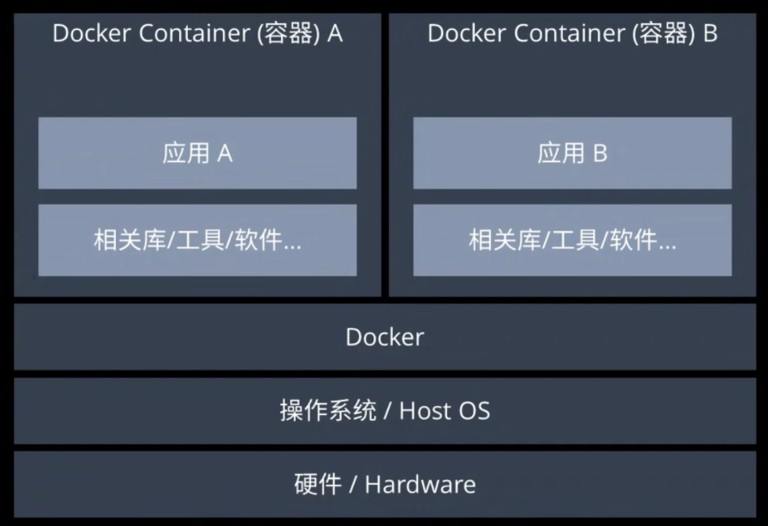
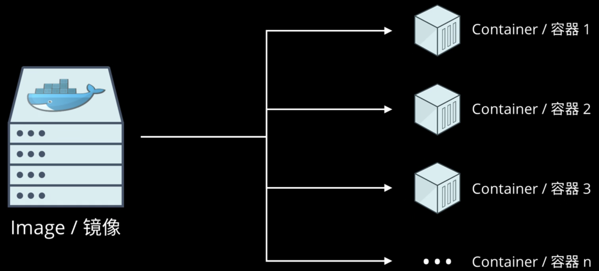

# Docker学习笔记

## 1. Docker解决的问题

比如你写了一个web应用，并且本地调试没有任何问题，此时你想把这个应用发给你的朋友看看，或者部署到云服务器上，首先，你需要配置相同的软件（比如数据库，web服务器，必要的插件，库等等），而且还不能保证一定能运行起来，因为操作系统可能不一样（MacOS，Windows，Linux）

为了模拟完全相同的本地开发环境，我们自然会想到虚拟机，但是虚拟机太臃肿，占用太多内存与计算资源

Docker与虚拟机在概念上类似，但轻量很多，Docker不会去模拟底层硬件，只会为每一个应用提供完全隔离的运行环境。这个环境被称为**Container**

## 2. Docker的核心概念

- **容器（Container）：**轻量化的运行实例，包含***应用代码***、运行时环境和依赖库。
  - 基于镜像创建，与其他容器隔离，共享主机操作系统内核（比虚拟机更高效）。
  - 容器像一台台已经运行起来的虚拟机，每个虚拟机/容器都运行了你写的程序，每个容器都是独立运行的，互相不影响。因此每个容器可以运行不同的你写的程序
- **镜像（Image）：**只读模板，定义了容器的运行环境（如操作系统、软件配置等）。
  - 不包含你写的应用的代码
  - 通过分层存储（Layer）优化空间和构建速度。
  - 类比，游戏存档，比如你打到了锁妖塔第一层的存档点，镜像就是你在此刻的存档，后续你可以任意读取这个存档点，比如你想从锁妖塔第一层开始挑战速通，或者从锁妖塔第一层开始挑战拿到锁妖塔所有宝箱。
- **Dockerfile：**文本文件，描述如何自动构建镜像（例如指定基础镜像、安装软件、复制文件等）。
  - 像是在虚拟机中安装操作系统和软件一样
- **仓库（Registry）：**存储和分发镜像的平台，如 Docker Hub（官方公共仓库）或私有仓库（如 Harbor）。

