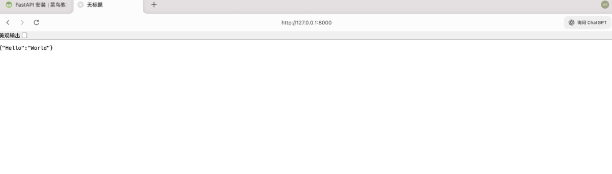

# Fast API笔记

## 1. 第一个 FastAPI 应用

创建一个名为 main.py 的文件，添加以下代码：

```python
from fastapi import FastAPI

app = FastAPI()

@app.get("/")
def read_root():
  return {"Hello": "World"}
```

在命令行中运行以下命令以启动应用：

```bash
uvicorn main:app --reload
```

现在，打开浏览器并访问 **http://127.0.0.1:8000**，能看到 FastAPI 自动生成的交互式文档，并在根路径 ("/") 返回的 JSON 响应。



### ✅  `FastAPI()` —— 创建应用实例

```python
app = FastAPI()
```

- `app` = **整个后端应用**
- 所有接口（API）都挂在它下面
- 类似：
  - Flask 里的 `app = Flask(__name__)`
  - Spring Boot 的 Application

### ✅ 路由（Route / Endpoint）

```python
@app.get("/")
def read_root():
```

这是一个 **路由定义（Route / Endpoint）**

含义是：

- **HTTP Method**：GET
- **URL Path**：`/`
- **处理函数**：`read_root`

👉 用户访问：

```
GET http://127.0.0.1:8000/
```

👉 就会执行 `read_root()`

### ✅ 返回值 = JSON（自动）

```python
return {"Hello": "World"}
```

- 返回的是 **Python dict**
- FastAPI 会自动转成 **JSON**
- 并设置好 `Content-Type: application/json`

你不用手写 `json.dumps()`（这是 FastAPI 很爽的地方）

------

### ✅ 启动服务：Uvicorn 是什么？

```bash
uvicorn main:app --reload
```

### 拆解：

- **Uvicorn**：ASGI Server（服务器）
- `main`：文件名 `main.py`
- `app`：FastAPI 实例
- `--reload`：代码改了自动重启（开发用）

👉 本质是：“用 uvicorn，把 main.py 里的 app 跑起来”

------

### ✅ 浏览器访问发生了什么？

访问：

```
http://127.0.0.1:8000
```

发生流程：

1. 浏览器发 GET 请求
2. FastAPI 匹配 `/`
3. 调用 `read_root()`
4. 返回 JSON
5. 浏览器显示结果

## 2. FastAPI自带API文档生成（Swagger）

接下来我们来丰富下代码功能，并做具体说明。

以下的 FastAPI 应用，使用了两个路由操作（**/** 和 **/items/{item_id}**）：

```python
from typing import Union
from fastapi import FastAPI

app = FastAPI()

@app.get("/")
def read_root():
    return {"Hello": "World"}

@app.get("/items/{item_id}")
def read_item(item_id: int, q: Union[str, None] = None):
    return {"item_id": item_id, "q": q}
```

### ✅ 路径参数 & 查询参数（非常重要）

```python
@app.get("/items/{item_id}")
def read_item(item_id: int, q: Union[str, None] = None):
```

#### 🔹 Path Parameter（路径参数）

```python
/items/{item_id}
```

- `{item_id}` 是 **路径参数**
- URL 中的一部分
- 必须提供

示例：

```
/items/5
```

👉 `item_id = 5`

------

#### 🔹 Query Parameter（查询参数）

```python
q: Union[str, None] = None
```

- 查询参数：`?q=xxx`
- **可选参数**
- 没给就是 `None`

示例：

```
/items/5?q=runoob
```

👉 参数解析结果：

```json
{
  "item_id": 5,
  "q": "runoob"
}
```

------

#### 类型注解（FastAPI 的核心优势）

```python
item_id: int
q: Union[str, None]
```

这是 **Python Type Hint（类型注解）**

FastAPI 会用它来：

- ✅ 自动校验参数类型
- ✅ 自动生成 API 文档
- ✅ 参数错误自动返回 400

比如：

```
/items/abc
```

👉 会直接报错（因为 `item_id` 必须是 int）