# RAG (Retrieval Augmented Generation)

- 降低推理成本
- 减少幻觉

## 为什么需要RAG

应用于商业时，模型不了解公司内部的数据。如果每次都把公司内部资料发给他，会造成

1. 上下文窗口限制；
2. 推理成本高；
3.  速度慢；

# 1. RAG的核心工作流程

RAG (Retrieval Augmented Generation)

- Retrieval：检索
- Augmented：增强
- Generation：生成

为方便理解，可以拆分为两个阶段：1. 数据准备阶段（业务线）。2. 回答生成阶段（用户线）

## 1.1 数据准备阶段

### （1）文档 -> chunking

- 文档太长，拆分文档为chunks
- 目的是将长文拆分成方便管理的短碎片，克服大模型吃不下长文的难题

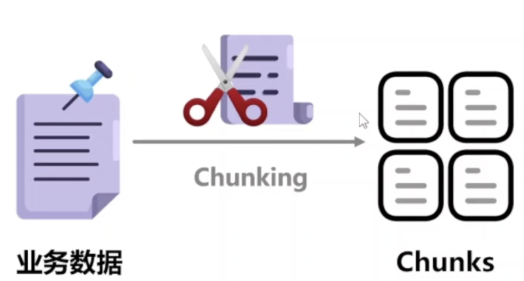

### （2）chunking -> Indexing

将chunks存在一个仓库，这个仓库叫做向量数据库 （Embedding 模型：负责将文字转化为向量表示， 我喜欢吃鱼 [0.21, 0.85, 0.13, ...] 我爱吃海鲜 [0.23, 0.82, 0.15, ...] 今天天气真好 [0.88, 0.12, 0.41, ...] ）

- Embedding: 将文字用向量表示，向量数据库存储“向量+原始文本”的对照表

  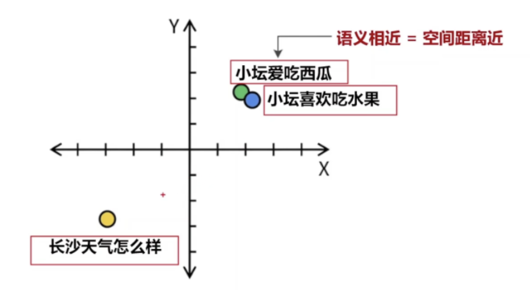

  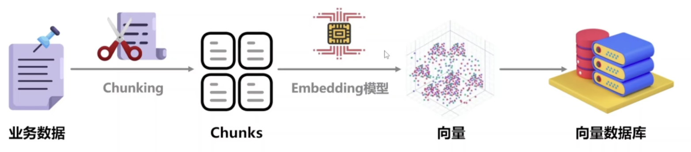

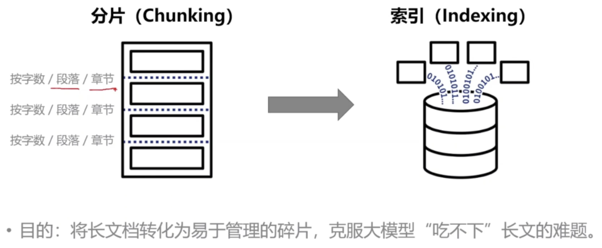

## 1.2 回答生成阶段

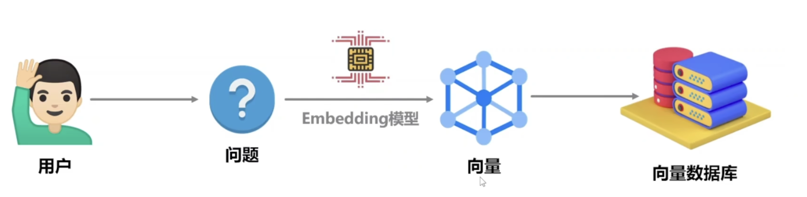

用户提问问题，系统将用户的问题也送入Embedding 模型，翻译成一个带坐标的向量。将这个问题向量与向量数据库的向量做比较（计算相似度，并排序）

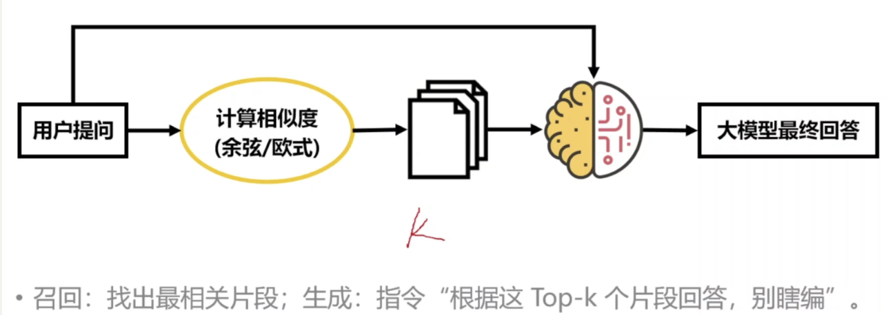

- 召回：系统选出相似度最高的 TOP-K个文本片段
- 合成（增强和生成）：将这Top—K个片段和用户问题一起打包成上下文（context）

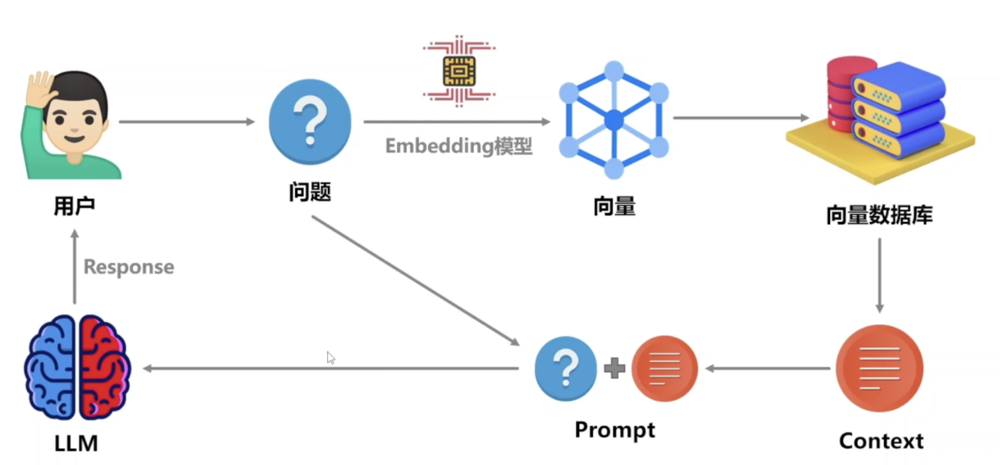

上图中：

- Context：即Top-K个文本片段
- Prompt： Context+用户最初的问题+一个system prompt
  - system prompting通常这么写：大模型，请你严格根据我提供的这几个片段来回答问题，不知道就说不知道，不要瞎编
- 将Prompt喂给LLM，LLM生成回答返回给用户

# 2. 商业化落地实战痛点

## 2.1 痛点：文档解析

在真实的业务场景中，文档通常非常复杂，并不是干净文本。使用普通的开源解析期去读，可能会读出乱码，错行......

解决方案：专用的版面分析模型+OCR+人工复合反馈（RLHF）

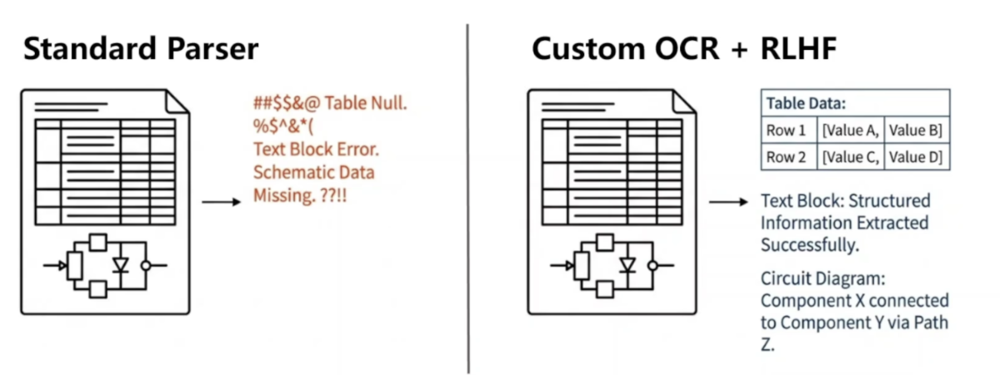

## 2.2 痛点：颗粒度（如何chunking）

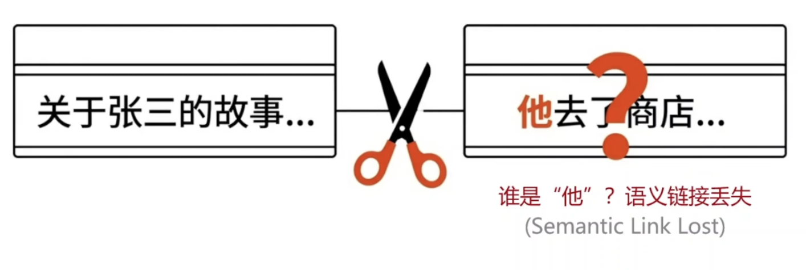

- 切太大 = 噪音多
- 切太小 = 语义丢失
- 需要考虑是否需要chunks重叠，比如每个chunks百分之10的内容和相邻的chunks是重复的（可以在一定程度上保证语义不丢失）

需要根据业务场景大量测试分片策略

## 2.3 痛点：检索准确率

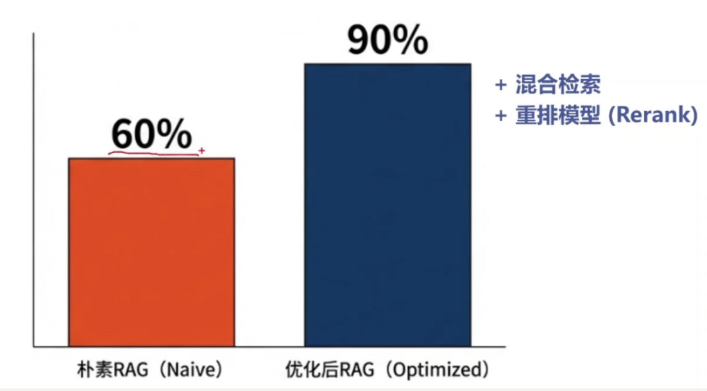

 检索准确率可以简单的理解为，向量数据库里选择了10个chunks和用户问题的相似度最高，但是实际上有用的只有6个

- 混合检索：既用向量相似度去找，又用传统的关键词搜索去找
- 重排混合检索的结果

## 2.4 痛点：用户提问的模糊性

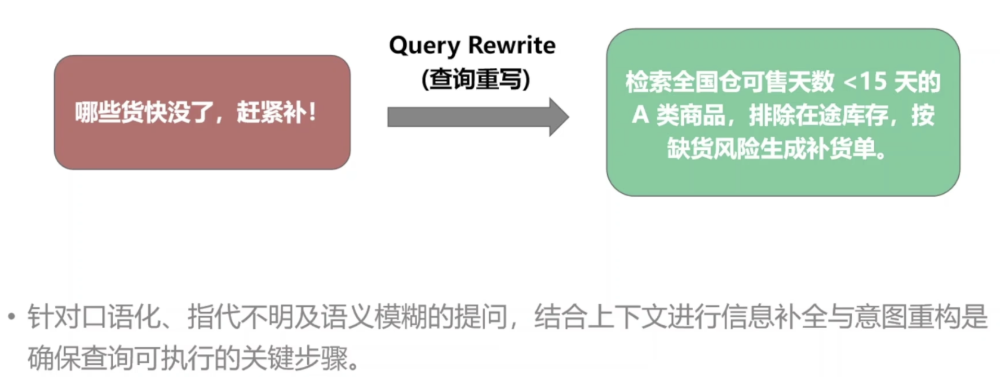

日常交流经常没头没尾，或者指代不明。需要Query Rewrite。

# 3. 进阶方案与总结

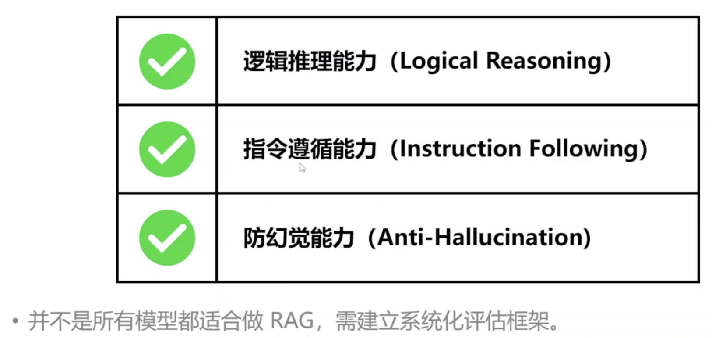

- 逻辑推理能力：能更好的理解因果关系
- 指令遵循能力：只根据资料回答，字数不超过50字
- 防幻觉能力：不瞎编，如实回答

## 3.1 GraphRAG

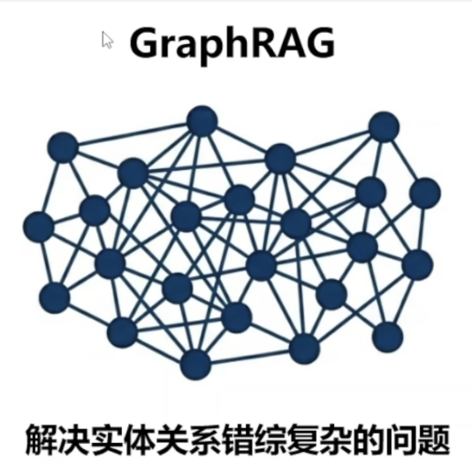 

## 3.2 Agentic RAG

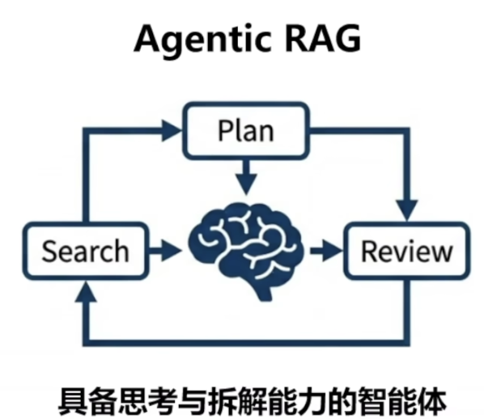

## 3.3 多模态，自救拓......