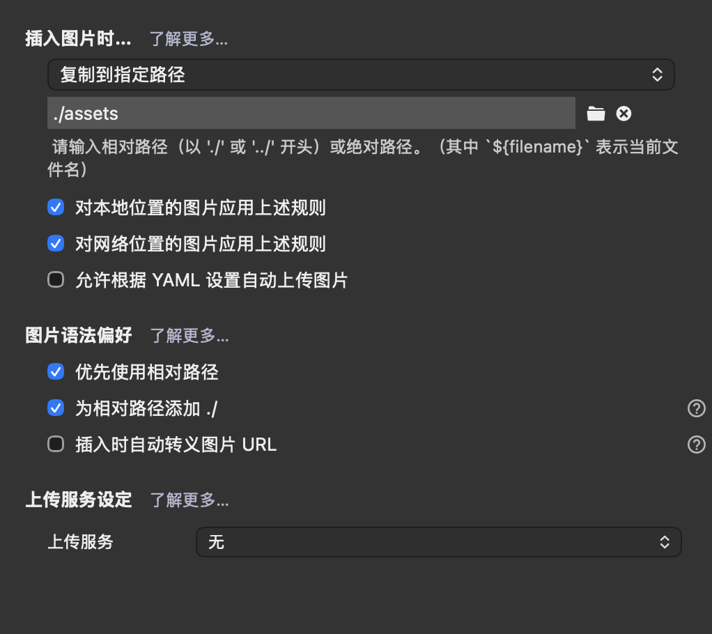

# zy-Notes

## 记得定期 update 笔记到 GitHub !!!

```bash
git add .
git commit -m "Notes update"
git push
```


## 2026/10/15

笔记使用本地 Typora 制作，为了在 GitHub 上显示图片，需要在本地更改图片设置，设置 -> 图像 选择“复制到指定路径”，设置路径名为`./assets`，然后勾选下图选项：


