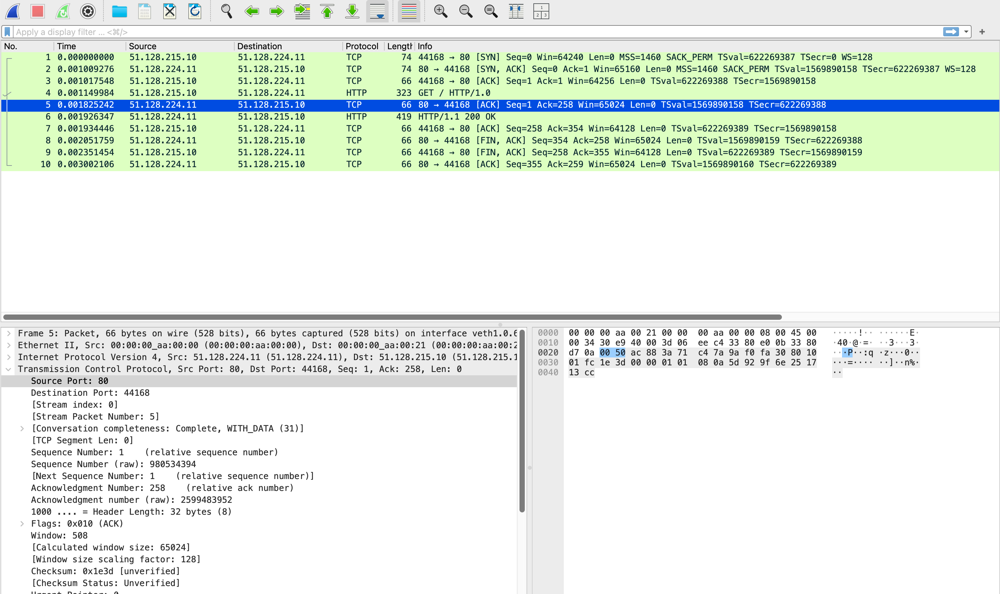
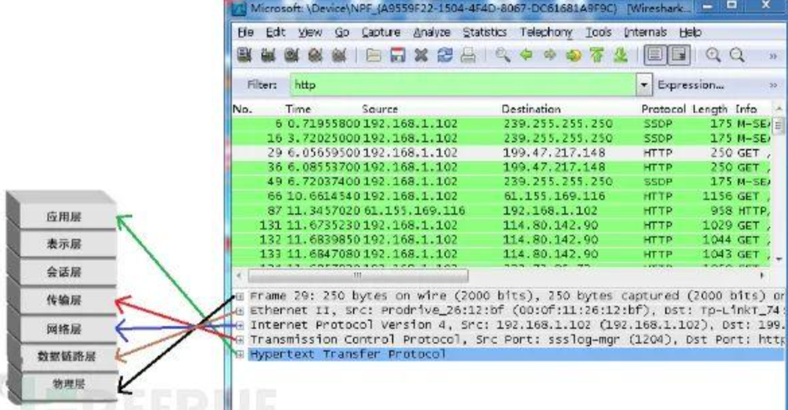
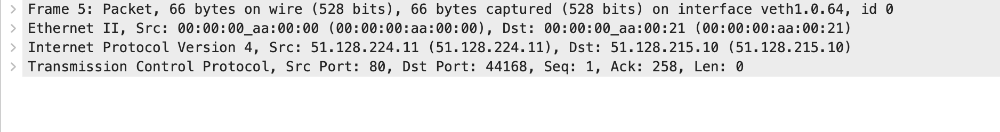
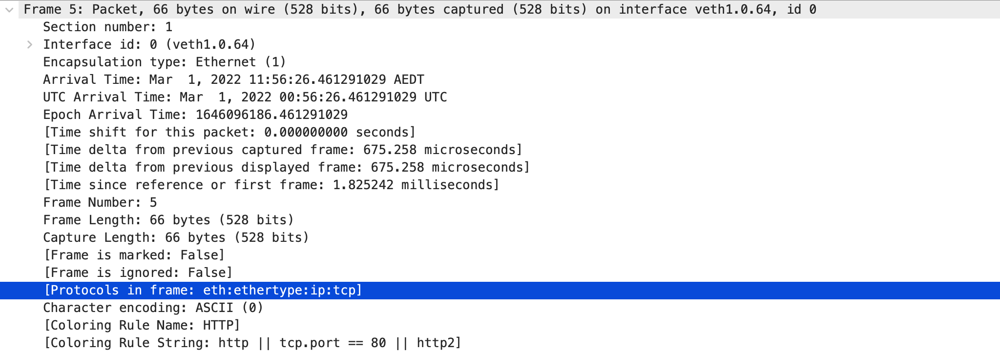
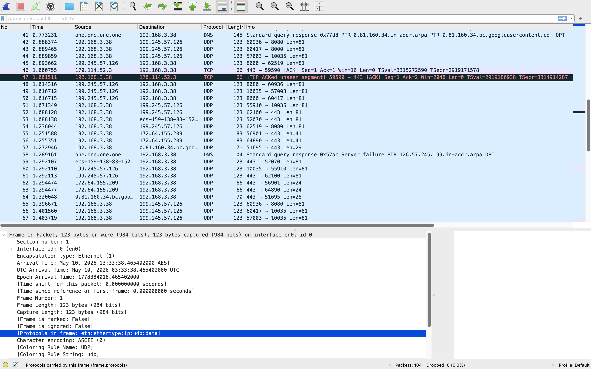
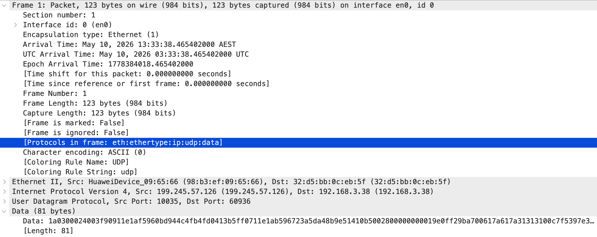

约定：

- 数据包：数据的统称，不特定指frame，packet，segment等等


# 界面简介



上图中分为几个界面

1. Display Filter（显示过滤器）

   1. 位于上方搜索框
   2. 菜单路径：Analyze --> Display Filters。
   3. 用于设置过滤条件进行数据包列表过滤。

2. Packet List Pane(数据包列表)， 

   1. 指上图中绿色的部分
   2. 显示捕获到的数据包，每个数据包包含
      1. 编号，
      2. 时间戳，
      3. 源地址: 可能是MAC或者IP，取决于数据包是哪一层的
      4. 目标地址，
      5. 协议，
      6. 长度：整个frame（layer1数据）的长度，序列号（比如ack和syn等）一般指payload开始的序列号，因此不能直接拿 $ack \# + length=下一个seq\#$
      7. 数据包信息。

3. Packet Details Pane（数据包详细信息）

   1. 上图中下半部分左侧

   2. 它按网络分层展示一个 packet/frame 的结构。

   3.  在数据包列表中选择指定数据包，在数据包详细信息中会显示数据包的所有详细信息内容。数据包详细信息面板是最重要的，用来查看协议中的每一个字段。各行信息分别为

      1. Frame: 物理层的数据帧概况
      2. Ethernet II: 数据链路层以太网帧头部信息
      3. Internet Protocol Version 4: 互联网层IP包头部信息
      4. Transmission Control Protocol: 传输层T的数据段头部信息，此处是TCP
      5. Hypertext Transfer Protocol: 应用层的信息，此处是HTTP协议

   4. 注意：

      1. 一个数据包可以看作是一个洋葱，从 layer 1 到 layer 7每多一层，就剥一层皮

      2. Packet Details Pane自上而下每一行就代表每一层，**开头是协议名词**

         1. **Packet Details pane** 里自上而下展示的是：这个被捕获的数据在网络协议栈中一层一层封装后的结构。
         2. 它显示的是 **从外层到内层** 的封装结构，而不是严格“自下而上”。
         3. 逻辑上是不停的拆封装，所以大体上是按照网络模型的顺序来拆

         


如果是访问网页，一般可以看到：

```text
Frame
└── Ethernet II
    └── IPv4
        └── TCP
            └── TLS / HTTP
```


# Packet Details Pane（数据包详细信息）



- 第一行代表 layer 1 physical layer
- 第二行代表layer 2 data link layer（协议是 Ethernet II）
- 第三行代表layer 3 network layer （协议是 IPv4）
- 第四行代表layer 4 transport layer （协议是 TCP）

点开第一行



选中的一行展示了这个frame中存在的协议有哪些（注意顺序），可以对照上面两张图


下图是实时抓的

     


# 琐碎

**ICMP Echo Request** 就是 **ping 请求包**。

当你运行：

```bash
ping 10.0.0.11
```

你的电脑会发送一个 **ICMP Echo Request** 给 `10.0.0.11`。

如果对方在线、网络可达，并且没有被防火墙拦截，它会返回：

```text
ICMP Echo Reply
```

也就是 **ping 回复包**。

------

## **echo 是什么意思？**

**echo** 最常用的意思是：

**回声 / 回响**

在网络里，**Echo Request** 可以理解为：

```text
我发一个消息给你，你收到后原样回给我。
```

就像你对山谷喊：

```text
Hello!
```

山谷回响：

```text
Hello!
```

所以：

```text
Echo Request = 你发出的“回声请求”
Echo Reply = 对方返回的“回声响应”
```

------

## **ICMP Echo Request 的作用**

它主要用于测试：

```text
1. 目标主机是否在线
2. 网络是否可达
3. 往返延迟是多少
4. 是否有丢包
```

例如：

```bash
ping google.com
```

可能显示：

```text
64 bytes from google.com: icmp_seq=1 ttl=115 time=18.5 ms
```

意思是：

```text
收到了 Echo Reply
往返时间大约 18.5 ms
```

------

## **结合你的截图**

截图里：

```text
10.0.0.21 → 10.0.0.11 ICMP Echo Request
10.0.0.11 → 10.0.0.21 ICMP Echo Reply
```

意思是：

```text
10.0.0.21：你在吗？
10.0.0.11：我在。
```

一句话总结：

**ICMP Echo Request** 是 ping 发出去的测试请求；**echo** 的意思是“回声”，表示希望对方收到后回一个 **Echo Reply**。


